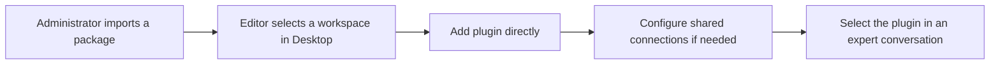

Select **+** in the Desktop sidebar to open **Discover & add**. Its four categories serve different purposes.

| Category | When to use it | Result |
| --- | --- | --- |
| Digital experts | Work with an existing published expert | Open a conversation, or request access first |
| Apps | Enable a solution with experts, views, and business resources | Initialize the app and open its entry expert |
| Plugins | Inspect capabilities available to an expert workspace | Workspace editors add packages directly; users select capabilities in ChatKit |
| Agent templates | Create your own expert from a predefined configuration | Install a new expert in a workspace you can edit |

Apps provide complete solutions, plugins add capabilities, digital experts provide the interaction entry point, and templates create new experts.

## Digital experts

1. Select your organization and open **Digital experts**.
2. Search by name, use case, or capability, or filter by category.
3. Review the description, publisher, and capability tags. Descriptions follow your interface language.
4. Open an accessible expert. For a restricted expert, describe your intended use and submit an access request. Pending requests remain visible in the catalog.

Permission to use an expert does not grant permission to edit it or expand its data access.

## Apps

An app can include collaborating experts, workbench views, knowledge resources, and initialization steps. App cards use softened screenshots as backgrounds; the details page includes a screenshot carousel.

1. Search or filter the Apps catalog and open an app's details.
2. Review its description, screenshots, initialization steps, and current state.
3. Configure required models and initialize the app when the preflight check allows it. Some apps require organization administrator access.
4. Once ready, open its entry expert and workbench.

If initialization is pending or has failed, refresh its status before trying again. Ready apps reuse their existing entry point.

## Plugins: add directly to an editable workspace

The **Plugins** tab lists workspaces you can edit in the current organization. Search and select a workspace directly; adding a plugin does not require selecting an expert first or opening the platform administration page.

1. Open **Discover & add → Plugins** and choose an editable workspace.
2. Inspect imported packages, their real icons, versions, and included capabilities.
3. Select **Add to workspace**. Review the destination and capabilities. Map required collaborator roles to published experts you can access.
4. Select **Add plugin**. Desktop prepares the workspace resources and refreshes the card to **Added**.
5. Open an expert belonging to that workspace and select the plugin in ChatKit's **Plugins** menu.

| State | Meaning |
| --- | --- |
| Added to this workspace | Available for conversation selection |
| Not added to this workspace | Can be added directly in Desktop |
| Disabled in this workspace | Contact an administrator; adding again cannot bypass a disabled publication |

Repeated additions reuse the existing active workspace binding. They do not duplicate it, change other workspaces, or modify conversation selections. The server rechecks edit access for every request, and users without editable workspaces see an empty state.

Workspace editors see display metadata for imported organizational packages, not source locations, MCP configuration, or credentials. Git/ZIP import, organization-level version management, disabling, and restoring remain administrator operations. Shared connection creation and authorization retain their existing permissions; an administrator may need to prepare a dependency before installation. Adding a plugin grants no third-party data access and does not alter an expert's published graph.

ChatKit continues to manage per-conversation selection and runtime availability. Some native service connections are selectable directly without importing an Agent Plugin package.

### Connect from Desktop

When configuration or authorization is needed:

1. Choose **Connect account** in the conversation plugin menu. Desktop opens the browser directly when ChatKit sends the command, without an extra confirmation dialog. Xpert automatically enters the target service connection flow. If needed, sign in with the same account and organization as Desktop.
2. Complete the service authorization, credential form, or QR flow. OAuth continues in the browser tab that started the connection to preserve the authorization session.
3. Desktop checks the server automatically. Once the connection is ready, the native app returns to the foreground, clears the non-blocking waiting status, and resumes plugin selection. No manual connection check is needed.

Waiting expires after 10 minutes and can be retried. Cancelling or switching experts stops Desktop from waiting; it does not revoke authorization already completed on the server. Your message draft stays in Desktop. Authorized users can consume an existing shared connection; configuring it still requires management permission.

Conversation selection does not change the expert's published graph. Changes apply to the next execution; an active execution retains its starting configuration. See [ChatKit plugins, middleware, and digital experts](/en/ai/chatkit/chatkit-agent-plugins) for version and authorization rules.

## Agent templates

1. Choose a template and review its description.
2. Select a workspace you can edit and enter the new expert's name.
3. Install and open the newly created expert, then continue configuring it as needed.

Installing a template creates a new expert rather than opening an existing one. Resources belonging to a complete app should be initialized through **Apps** to preserve their dependencies.

## Troubleshooting

**An imported plugin is missing from ChatKit.** Check publication to the current expert's workspace, whether the publication is enabled, and user access. Imported, published, and selected are separate states.

**Does adding a plugin select it for all conversations?** No. It makes the capability available in the workspace. Select it explicitly through ChatKit for each conversation.

**A service is connected but capabilities remain unavailable.** Connection authorization does not grant publication or data access. Check workspace availability, component configuration, and service permissions.
