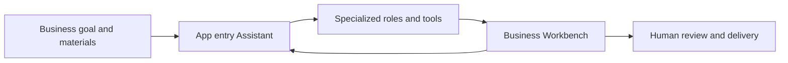

**Plugin Apps**, also called Agentic Apps, are business applications delivered through the Xpert plugin system. An app combines an entry Assistant, specialized tools, business interfaces and supporting resources for a particular workflow. Users assign work in chat, operate on business objects in Workbench and inspect the results.

For example, a document preparation app might provide material uploads, outline planning, section writing and review. A case management app might organize materials, processing steps and results around a single case. Each app defines its own workflow and deliverables.

This section explains the shared app experience and provides a home for **official application product documentation**. Individual apps will have their own introductions, quickstarts and operating guides. See the [Official app directory](./catalog).

## What an app provides

| Product capability | User experience |
| --- | --- |
| A business entry point | Open the Assistant responsible for the workflow and understand supported tasks and required materials |
| Specialized roles | An app can combine an entry Assistant, collaborating roles and standalone experts according to its declared workflow |
| Business Workbench | View, edit or review business objects alongside chat, advancing their state through the app's rules |
| Supporting resources | Initialize the app's declared workspace, knowledge bases and tool configurations for ongoing maintenance |
| Project and task integration | Apps that implement this integration reuse project membership, files, task views and execution records |
| Inspectable results | Review business records, files or Artifacts, then confirm and deliver through the app's workflow |

These capabilities can be combined by an app. Check its product documentation and actual interface for support for project tasks, knowledge bases, collaborating roles or export.

## Where to start

<CardGroup cols={2}>
  <Card title="Complete your first app task" icon="play" href="/en/ai/applications/quickstart">
    Open an app, provide materials and inspect the results of a small business workflow.
  </Card>
  <Card title="Official app directory" icon="grip" href="/en/ai/applications/catalog">
    Understand this section's coverage and find the right product documentation.
  </Card>
  <Card title="Discover and enable apps" icon="circle-plus" href="/en/ai/applications/app-guide/discovery-and-setup">
    Learn about app details, prerequisites, tool configuration and initialization states.
  </Card>
  <Card title="Projects and task collaboration" icon="list-check" href="/en/ai/applications/app-guide/projects-and-tasks">
    Choose the right business project and follow tasks, execution and acceptance.
  </Card>
</CardGroup>

## Relationship to Bosi, plugins and templates

| Entry | Main purpose |
| --- | --- |
| [Bosi App](/en/ai/bosi/index) | The desktop workspace for discovering, enabling and using business apps |
| Plugin App | A business solution with initialization, authorization and maintenance, used through its published Assistant |
| [Plugin development](/en/ai/plugin/overview) | Implement platform tools, services and views, and deliver applications |
| [Assistant templates](/en/ai/agent/conversation/assistant-templates) | Create independent Assistant instances from reusable definitions |
| [Projects & Tasks](/en/ai/projects/index) | Organize ongoing collaboration, tasks and execution records |

App visibility depends on the plugins loaded by the service and the current organization scope. A ready app still requires use authorization. Business data, projects and external services retain their own access rules. See [Access and app maintenance](./app-guide/access-and-updates).
