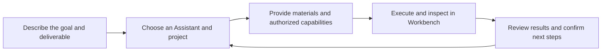

**Bosi (Xpert Bosi) is the Xpert platform's desktop app and an entry point for organizing AI work. You set the goal. Bosi leads the team.**

Use your personal Bosi for everyday work, add your organization's digital experts and business apps, or invite colleagues and Assistants into a group. Conversations capture goals, clarification and approvals; Workbench presents materials, business interfaces, task progress and delivered results.

<CardGroup cols={2}>
  <Card title="Get started with Bosi" icon="rocket" href="/en/ai/bosi/quickstart">
    Install, sign in, create your Bosi and complete a first task with clear delivery requirements.
  </Card>
  <Card title="Organize your experts" icon="users" href="/en/ai/bosi/daily-work/assistants-and-apps">
    Discover experts, initialize apps and add plugins to keep useful capabilities within reach.
  </Card>
  <Card title="Collaborate through projects" icon="list-check" href="/en/ai/bosi/daily-work/projects-and-groups">
    Share project materials and tasks, and coordinate people and Assistants in groups.
  </Card>
  <Card title="Use computers and coding tools" icon="desktop" href="/en/ai/bosi/daily-work/computers-and-coding">
    Choose a cloud computer, server sandbox or authorized local Shell for the work.
  </Card>
</CardGroup>

## Work in one window

| Area | What you can do |
| --- | --- |
| Organization and sidebar | Switch organizations, find Assistants and groups, pin useful entries and organize personal sections |
| Conversation | Explain goals, attach materials, select plugins and skills, inspect tool results and respond to approvals |
| Assistant character and summary | Check activity, results and computer entries, and customize the public name and appearance when authorized |
| Workbench | Inspect app interfaces, project tasks, files, charts or a cloud computer beside the conversation |
| Settings | Adjust personal presentation, connect services, inspect usage and control local execution permissions |

For example, ask Bosi to prepare an assessment from project materials, involve relevant experts to check information, inspect the report and task progress in Workbench, then review and download the delivered file. Available tools and apps come from the connected Xpert service.

## The app, your Assistant and the platform

| Name | Meaning |
| --- | --- |
| Bosi App | The installed desktop client, with sidebar, connection management, conversations and Workbench entries |
| Your Bosi | Your personal Assistant in the current organization, with configurable models and capabilities |
| Digital experts and Agentic Apps | Published specialist Assistants and business apps, available according to their permissions |
| Xpert platform | Model access, Assistant execution, business resources, projects, publication and authorization |

Bosi needs a network connection to Xpert. Installing it does not install the backend locally or grant an Assistant unrestricted access to your computer. Models, cloud computers, plugins, voice and external services depend on deployment, configuration and authorization.

## Start with your goal

- Perform specialized work: [Experts, apps and plugins](./daily-work/assistants-and-apps).
- Deliver ongoing work: [Projects and group collaboration](./daily-work/projects-and-groups).
- Inspect progress and results: [Conversations, Workbench and delivery](./daily-work/conversations-and-workbench).
- Run code or operate a computer: [Computers and development](./daily-work/computers-and-coding).
- Adjust the experience: [Personalization, settings and updates](./desktop-guide/personalization-and-settings).
- Resolve connection, initialization or execution issues: [Troubleshooting](./desktop-guide/troubleshooting).

Step-by-step installation remains in the [Bosi Desktop App User Guide](/en/ai/tutorial/bosi-desktop-user-guide). For practical development exercises, see [Develop with Bosi](/en/ai/tutorial/develop-with-bosi).
