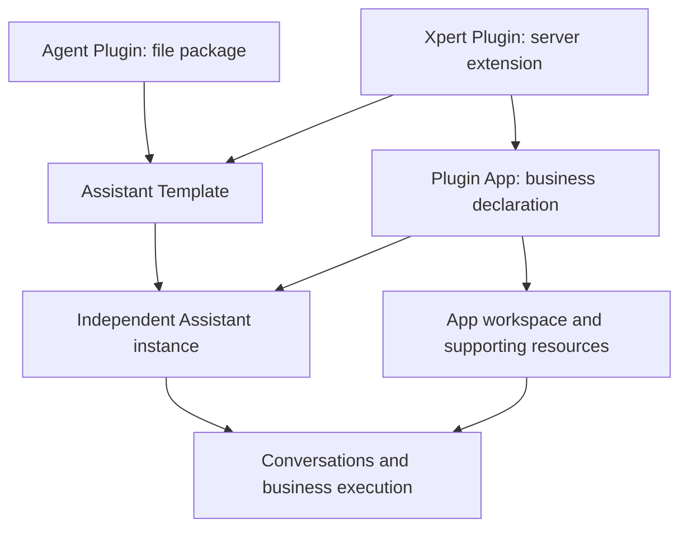

Xpert uses plugins to deliver capabilities, apps to organize business solutions, and templates to create Assistants. Start by identifying whether you need new server functionality, a reusable configuration package, a complete business app, or your own Assistant.

## Four related concepts

| Concept | Product entry | Delivered content | Result |
| --- | --- | --- | --- |
| Agent Plugin | Agent Plugins | Files such as skills, MCP configuration, Assistant templates, and assets | Templates become discoverable; other resources are added to workspaces or selected in conversations with appropriate access |
| Xpert Plugin | Xpert Plugins | Native server extensions, optionally with skills, templates, and app declarations | Actual server capabilities or installable resources become available |
| Plugin App / Agentic App | Apps | A business solution composed through a plugin's `appConfig` | Initializes a business workspace, entry Assistant, and declared supporting resources |
| Assistant Template | Agent templates | Reusable roles, execution configuration, dependencies, and initialization requirements | Creates an independent Assistant in a destination workspace |

These are not four mutually exclusive file formats. Both Agent Plugins and Xpert Plugins can deliver Assistant Templates. A Plugin App can reference templates to initialize its entry and collaborating roles. Users converse with the resulting published Assistant instances.

## Choosing an approach

| Need | Recommended approach | Reason |
| --- | --- | --- |
| Distribute office roles, skills, MCP configuration, and initial ledgers | Agent Plugin + Assistant Template | Files support distribution, versioning, and reuse |
| Add tools, endpoints, entities, or integration strategies absent from the platform | Xpert Plugin | Requires executable server implementation |
| Deploy a multi-role solution with a business workbench and knowledge resources | Plugin App contributed by an Xpert Plugin | Requires resource composition, initialization state, and stable app identity |
| Create an editable personal or team Assistant from an existing role | Import an Assistant Template | Creates your instance for customization and explicit upgrades |
| Work with an existing expert | Digital experts catalog | Opens a published instance without importing another template |

File packages depend on models, tools, sandboxes, and connectors already supported by the destination system. MCP configuration can describe a service connection without implementing the service itself. Install a native extension when new server functionality is needed, then reuse it across multiple file-based templates.

## Where capabilities belong

The Assistant definition determines its responsibilities: roles and instructions, actual skill dependencies, tools, first-use requirements, and routines. A plugin is the delivery vehicle and should not maintain a duplicate inventory of Assistant capabilities.

Template details derive Memories, Skills, Routines, and Integrations from these declarations. App highlights explain business value, while app composition lists actual roles and resources. These sections should not repeat the same marketing copy.

Dependency binding resolves a template reference to an actual resource in the destination environment, such as a skill, MCP service, or toolset, and records its version. It does not bind marketing text or grant all capabilities in a plugin.

## Importing, adding, authorizing, and using

| Action | Effect | What may remain |
| --- | --- | --- |
| Administrator imports an Agent Plugin | Validates and stores the organization's package and version | Import templates or publish workspace resources as needed |
| Install an Xpert Plugin | Loads server implementations and resources at the required scope | Configure it and restart the service if requested by the platform |
| Add a plugin to a workspace | Makes resources available to authorized workspace users | Configure connections and select resources in the applicable conversation entry |
| Import an Assistant Template | Creates an Assistant, installs selected dependencies, and initializes content | Configure models, accounts, preferences, and publication |
| Initialize an app | Creates or reuses the organization's composed app resources | Assign maintenance/use permissions and business configuration |
| Authorize an external service | Establishes a connection to a destination account | Workspace, Assistant, and third-party access requirements still apply |

Copying package files distributes them; platform validation is still required before use. Installation does not sign into third-party accounts. A ready organization app does not grant every employee access. Workspace editing and published-Assistant use permissions are managed separately.

Apps currently initialize private workspaces maintained by the initializer. Business users receive published-Assistant access through organization groups. See [Application configuration](/en/ai/plugin/application-config) and [Assistant and application authorization](/en/ai/system/permissions/assistant-application-authorization).

## Office Ops and the template series

Office Ops is a file-based Agent Plugin containing a template, seven office skills, initial ledgers, and initially paused routines. It does not require a dedicated NestJS module for the role. Models, file operations, approval, and scheduling use existing platform capabilities.

The plugin repository's `agent-plugins/assistants/` directory manages Office Ops alongside 89 other template packages. Categories cover sales and customers, marketing, operations, personal tasks, product management, design and creativity, engineering, and recruiting. Categories support discovery without changing permissions or execution behavior.

Templates share a consistent avatar series. English and Chinese names and descriptions follow the interface language; internal skills and execution instructions need not be translated. Plugin icons and Assistant avatars are separate configuration surfaces, so changing a plugin icon does not automatically update its template avatar.

These roles use Xpert's template contract; direct import of another product's private template files is not promised.

## Versions and upgrades are separate

Package versions describe delivered content. Template-source versions determine available instance upgrades. Accounts, preferences, conversations, files, and task state belong to actual instances.

Installing a new package version does not silently overwrite existing Assistants. Users inspect changes and local conflicts in an upgrade preview, save a draft, and publish the new definition. App initialization repair is separate from template upgrades and database migration.

An explicit source migration can move a native-plugin template to an Agent Plugin after compatibility checks. Matching display names do not establish matching identity.

## Continue reading

- [Using Assistant templates](/en/ai/agent/conversation/assistant-templates): discovery, import, setup, routines, sharing, and upgrades.
- [Discover & add](/en/ai/agent/conversation/discover-and-add): operating the four entry points.
- [Application configuration](/en/ai/plugin/application-config): declaring and initializing business apps.
- [ChatKit plugins, middleware, and digital experts](/en/ai/chatkit/chatkit-agent-plugins): conversation selection and runtime boundaries.
