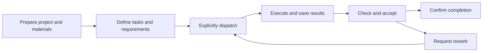

A project is a collaboration space for ongoing work. Bring together the relevant Assistants, people, files, instructions and conversations, then break the goal into tasks that can be assigned, tracked and accepted.

For example, preparing a competitor report may involve an analyst researching products, a data specialist checking prices and a writer composing the report after both inputs are accepted. The project holds shared resources and rules; tasks record responsibility, dependencies, execution attempts and acceptance decisions.

<CardGroup cols={2}>
  <Card title="Complete your first project task" icon="list-check" href="/en/ai/projects/quickstart">
    Create a project, prepare materials, ask an Assistant to plan and execute work, then check the deliverables.
  </Card>
  <Card title="Coordinate work in a group chat" icon="users" href="/en/ai/projects/tasks/group-collaboration">
    Connect a project, select participating Assistants and dispatch work in dependent batches.
  </Card>
</CardGroup>

## What a project contains

| Content | Purpose |
| --- | --- |
| Assistants and conversations | Choose who performs the work and retain requests and follow-up replies |
| Project instructions and skills | Share terminology, output standards and reusable methods |
| Members and connectors | Control who can use, edit and manage the project and which business systems are available |
| Files and deliverables | Share inputs, maintain working files and inspect delivered results |
| Plans and tasks | Organize milestones, assignees, priorities, dates and dependencies |
| Execution and acceptance records | Distinguish attempts, independent reviews, rework and final decisions |
| Scheduled tasks | Run a selected Assistant at a configured time as a confirmed user |

Human project membership, connected Assistants and group-chat membership are separate relationships. Joining a chat or enabling Project management on an Assistant does not grant project editing rights.

## From a goal to delivery

Creating a task saves the plan. Dispatch starts execution; successful implementation normally moves the task to **Review**. The responsible Assistant or an authorized user then accepts the result. A 100% progress indicator, successful tool call or “done” message does not replace an acceptance decision.

## Choose an entry point

| Entry | Use it to |
| --- | --- |
| Cloud project list | Find or create projects and open the full project workspace |
| Project Plan page | Organize plans, milestones, sprints and tasks |
| Project tasks page | Inspect the task tree, Gantt chart, status board and execution details |
| Project selector in an Assistant conversation | Select the work context before sending a request |
| Project tasks in conversation Workbench | Track work and acceptance alongside the conversation |
| Project menu below the group composer | Let the group owner connect a project and confirm participating Assistants |

Cloud and Desktop conversations share the Project tasks view. Full project-workspace instructions in this section use the Cloud entry. Available Assistants, application types, connectors and executors depend on your deployment and access.

## Continue by task

- First use: [Quickstart](./quickstart).
- Prepare the workspace: [Project types](./setup/project-types), [Assistants and context](./setup/assistants-and-context), [Members and permissions](./setup/members-and-permissions), [Shared files](./setup/files-and-deliverables).
- Manage delivery: [Planning](./tasks/planning), [Task views](./tasks/views), [Execution, acceptance and rework](./tasks/execution-and-review).
- Coordinate ongoing work: [Group collaboration](./tasks/group-collaboration), [Scheduled tasks](./automation/scheduled-tasks).
- Resolve an issue: [Troubleshooting](./help/troubleshooting).
