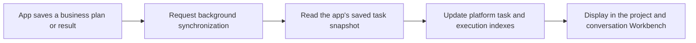

A plugin app can keep its own task model and use the SDK to map saved business facts into platform Project tasks. This mapping is a **task projection**: the platform stores information for shared tracking and scheduling, while the owning app handles business operations.

## Information that can appear together

| Application information | Project task presentation |
| --- | --- |
| Phase, work package or business plan item | Summary node, task or milestone |
| Business work category | Registered task type label and icon, such as outline preparation, chapter writing or illustrations |
| Task decomposition and prerequisites | Parent-child task tree and predecessor dependencies |
| Assigned executing Assistant | Task assignee |
| Business state and explicitly recorded completion percentage | Status indicator and progress percentage |
| Each claim, run, failure or new execution | A separate attempt under the relevant task |
| Associated conversation and Agent execution | An authorized entry to the exact execution |
| Failure reason and output summary | Diagnostics and an execution summary |

Structural kind, business type, state and progress convey separate facts. A chapter-writing task can have children; its icon does not establish completion, and 100% progress does not replace application acceptance. A summary or file path alone does not create a downloadable platform deliverable.

## From a business operation to the shared view

For example, after the app saves “Write the construction plan,” the task can appear as Todo. Once the app explicitly dispatches it, the same task records that attempt. After submission and the app's business checks, it maps to the appropriate business state. Further attempts on the same work should retain traceable execution records.

Current background synchronization is asynchronous. A queued request confirms that the platform received the synchronization request; the view can briefly show the previous saved state. A visible page reads data approximately every five seconds, which is not a guarantee of synchronization completion time.

<Note>
Opening or manually refreshing the view reads saved platform tasks and execution facts. It neither reruns Agents nor requests task synchronization on the app's behalf. Persistent delays require checking the app's synchronization submission and background diagnostics.
</Note>

## Keeping work connected over time

The app supplies stable source identifiers for business tasks and individual attempts. The platform uses them to associate the same task and execution records; a changed title does not create another piece of work on each synchronization. Renaming a task or changing display language should not change its identity.

In the bid app, a plan step can appear before its concrete business task is prepared. Preparation retains the same source identifier, and the app associates individual attempts with that task. Users can then inspect each process from a shared entry.

New business work needs a new business identity. Unrelated work or separate attempts should not be collapsed into one record merely to reduce the task count.

## Where to make changes

| Action | Entry point |
| --- | --- |
| Change a business objective, split tasks or adjust business dependencies | The owning app's plan or business tools |
| Start, retry or cancel business work, or confirm results | The app's actions, following its business rules |
| Adjust planned dates and estimated duration | Platform task details, with project editing rights |
| Inspect the tree, Gantt chart and execution status | Project tasks in the platform project or conversation Workbench |
| Investigate an individual attempt | That task's execution history or execution dot |

Platform scheduling does not change application dependencies or dispatch work when a date arrives. If concurrent schedule edits conflict, reload and review current data before saving again.

## Execution ending and business completion

An Agent run ending describes that attempt. The app may still need to check coverage, content quality, source materials or submission results before deciding that a business task is complete. The platform preserves the app's business state instead of replacing its decision with Runtime success.

For ordinary project tasks, the implementation-success, review and acceptance flow is described in [Execution and acceptance](../tasks/execution-and-review). Application-managed tasks use the app's own acceptance entry. Generic platform dispatch and acceptance tools cannot take over those tasks.

Opening an attempt resolves the saved execution association rather than “the latest conversation.” If the app supplied no navigable Agent execution, history is missing or access has changed, only a summary may be available. Another run's content cannot substitute for the missing record.

## Synchronization problems

| Symptom | What to do |
| --- | --- |
| The app saved a change but the platform still shows the previous state | Allow background synchronization and read again; check the app's saved result first |
| New tasks never appear | Check the business object's project association, application task support and successful submission of a synchronization request |
| A synchronization diagnostic appears | Ask the app maintainer to inspect the provider, organization scope and project access, then request synchronization again |
| Tasks are visible but business state cannot be edited | Use the owning app; this is a source-ownership restriction |
| An attempt has a summary but its process cannot be opened | Check for a real execution association and current access |
| The app is unavailable but old tasks remain | Retain the records for reference; restore the app and access before confirming current business state |

Failed background synchronization preserves saved platform tasks and records diagnostics; queued work can retry. If the business transaction succeeded but its synchronization request was never queued, the app must request synchronization again. Rerunning completed business work is not a remedy for a display synchronization problem.

See the [SDK integration guide](./sdk-integration) for implementation and verification.
