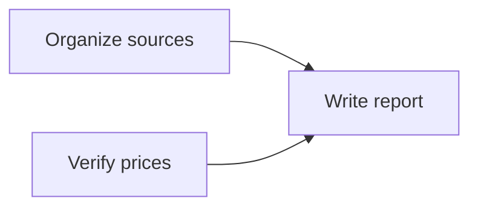

Define the deliverable before splitting the work. Each task should state a concrete goal, completion requirements and output so that an executor knows what to do and a reviewer knows what to check.

## Choose a management mode

Choose Simple or Advanced mode when creating the project. This controls planning structure; it is not a model reasoning mode and does not make tasks run automatically.

| Mode | Suitable for | Planning structure |
| --- | --- | --- |
| Simple | Everyday work and smaller deliveries | Four basic lanes: To do, In progress, Paused and Done |
| Advanced | Complex work with multiple stages or participants | Multiple plans, milestones and sprints |

The full task lifecycle also includes Review, Blocked and Cancelled. Use [Project tasks](./views) to inspect all statuses and execution facts.

## Create tasks on the Plan page

1. Open the project's **Plan** page and select the current plan.
2. Choose **Add task**, then enter its title, description, priority and due date in the details dialog.
3. Select an execution Assistant as needed. Advanced mode also supports plan and milestone assignment.
4. Save and confirm the task belongs to the intended plan. Describe the expected deliverable and have the responsible Assistant confirm verifiable completion requirements before dispatch.

The Plan page offers board, table, Gantt, calendar and list layouts. It organizes work; Project tasks focuses on dependencies, attempts and acceptance evidence. Moving a card or changing its status cannot bypass acceptance rules for a task with existing execution attempts.

You can also ask an Assistant with Project management to save the tasks:

> Split the competitor evaluation into source organization, price verification and report writing. Save completion requirements, an assignee and deliverables for each task. The report must wait until the first two tasks are accepted.

## Use plans, milestones and sprints

Advanced mode supports creating and editing plans, creating and editing milestones, and creating sprints.

| Object | Useful information | Example |
| --- | --- | --- |
| Plan | Work scope and plan status | This quarter's competitor evaluation |
| Milestone | Stage goal, status and due date | Complete source verification |
| Sprint | Iteration goal, strategy, dates and status | Finish the first report this week |
| Task | Executable goal, assignee, priority and requirements | Verify prices for three products |

Plans and sprints organize the work; execution records remain attached to individual tasks.

## Hierarchy and dependencies

Parent-child relationships describe how work is decomposed. Predecessor dependencies describe when work may be dispatched. Set them separately.

Here, report writing depends on source organization and price verification. All three may share a parent task, but that hierarchy alone does not prevent the report from starting early.

With editing rights, use the task detail **Overview** to change hierarchy, dependencies, planned start and end dates, and estimated duration. Predecessors must belong to the same project, dependencies cannot form a cycle and planned end cannot precede planned start. If saving conflicts with another edit, refresh and review the saved changes before trying again.

For application-owned tasks, change hierarchy and dependencies in the owning application. The generic task view preserves those restrictions. See [Business tasks and execution sync](../plugin-apps/business-tasks) for how app tasks connect to the platform.

## Scheduling does not dispatch work

Planned dates express expectations; execution intervals record actual runs. Changing dates, setting a deadline, adding dependencies or creating a task does not start execution.

After predecessors are accepted, the coordinator must explicitly dispatch the dependent task. For daily or weekly triggers, configure a separate [scheduled task](../automation/scheduled-tasks).
