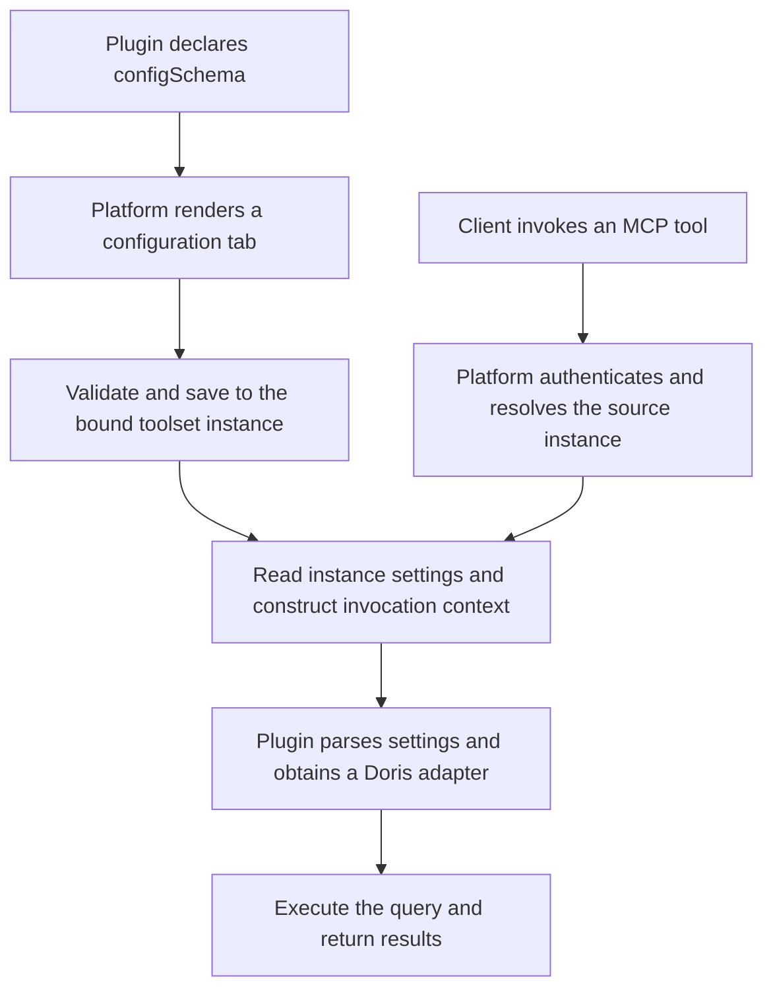

Developing a business plugin with MCP support connects three parts: business queries, connection settings, and service publication. For a Doris order query plugin, the plugin defines which data can be queried, which arguments each operation accepts, and what it returns. Xpert publishes those capabilities as an MCP service and provides authentication, configuration UI, and invocation management.

The **`xpert-plugin-development`** skill in `xpert-skills` provides engineering conventions and implementation guidance. This tutorial uses a fictional business query plugin to explain the development logic from business capability to MCP invocation, including how the platform supports plugin-defined `configSchema`.

## Define the business capabilities first

Assume Doris already has a `biz_order` table containing an order number, site, status, amount, update time, and active flag. The plugin exposes three read-only operations and one schema resource:

| Capability | Purpose | Information supplied at invocation |
| --- | --- | --- |
| `ping` | Check the connection and return the current database and database user | None |
| `get_server_time` | Read the database server time | None |
| `get_orders` | Query permitted order data | Optional site, row limit, and whether to include inactive orders |
| `schema://business/orders` | Describe the accessible order fields | Resource URI |

Development starts with these contracts. For example, `get_orders` defaults `limit` to 100 and `include_inactive` to `false`. Its result includes `data`, the number of rows returned in this batch as `rowCount`, and a `truncated` flag. Monetary precision, null handling, and stable ordering are also part of the contract.

The database host, password, and configured row cap belong to connection settings, so callers do not supply them with every query. The query implementation restricts access to allowed tables and binds filter values as parameters. A site filter is a query condition; data access permissions still require separate enforcement.

## How the skill, plugin, and platform divide the work

Development uses `xpert-plugin-development` from the [official xpert-skills repository](https://github.com/xpert-ai/xpert-skills), consulting its native MCP and MCP service configuration references as needed. The skill guides a development agent through the target SDK, project structure, implementation, and verification. At runtime, the platform loads and executes the plugin.

| Part | Responsibility |
| --- | --- |
| Development skill | Guide project structure, SDK usage, builds, tests, and delivery |
| Business query plugin | Define tools and resources, implement queries, declare configuration fields, and validate business rules |
| Doris data source plugin | Provide database connections, query adapters, and connection cleanup |
| Xpert platform | Load plugins, persist instance settings, render configuration forms, publish MCP services, and handle authentication, policy, and audit |

With these responsibilities established, development produces the business contracts, shared query service, tool declarations, configuration definition, and verification cases. The skill's guidance must be checked against the target platform and SDK versions, particularly for MCP configuration tabs and save validation. Loading a skill does not add those capabilities to an older platform.

## How a business method becomes an MCP tool

The plugin first places connection resolution, queries, and result conversion in a shared business service. It then declares capabilities through a native Tool Provider. `@XpertToolProvider()` describes the Provider, while `@XpertTool()` describes callable methods, their inputs, and read/write annotations. A resource declaration exposes the table schema.

When the platform loads the plugin, it discovers these declarations and registers the tools and resources. The plugin entrypoint, dependencies, manifest, and build outputs must also be complete so that the declarations and implementations reach the installed package. See [Host-Native MCP Tools](../plugin/host-native-mcp-tools) for the interfaces.

For external access, an **MCP Publication** combines selected capabilities and their source instances into an MCP service. A client connects to that service URL, and the platform routes each tool invocation to its plugin method. The platform handles Streamable HTTP, identity verification, permission policies, and audit, allowing the business plugin to focus on query behavior.

Plugin installation, capability registration, and MCP publication are therefore connected stages: installation brings code into the platform, registration makes capabilities discoverable, and publication determines which service exposes them.

## Describe the required settings with configSchema

This example defines a Provider `configSchema` with the title Connection settings. The schema describes fields and rules; the platform persists the actual connection values entered into the form.

| Setting | Business meaning | Form behavior |
| --- | --- | --- |
| `mode` | Use a platform data source or a manual connection | Explicitly select `platform` or `manual` |
| Platform data source | A Doris data source accessible to the current user | Show a data source selector in platform mode |
| Host, port, username, password, and database | Manual Doris connection details | Show in manual mode; default SQL port to 9030 and use a secret field for the password |
| `maxRows` | Maximum rows returned by one query | Default to 500; accept integers from 1 to 500 in this example |
| `queryTimeoutMs` | Database query timeout | Default to 30000 ms; accept integers from 1000 to 120000 in this example |

Field types, labels, conditional visibility, and control metadata come from the plugin's schema. The platform renders them with its shared form system, so this business plugin does not need a separate connection page. The plugin obtains data source choices through the existing data source capability and filters by the explicit Doris engine type. Opening a data source still checks the current caller's permissions.

The two modes have explicit execution paths. Platform mode opens an adapter through the data source runtime capability, with credentials managed by the platform. Manual mode uses the Doris plugin's public connection factory. A failed connection should return its error instead of silently switching to another configuration.

The plugin also needs configuration parsing and business validation. For example, manual mode requires a host and database, while platform mode requires a selected data source. `validateConfig` checks values before saving; parsing before execution handles defaults, existing settings, and current runtime conditions.

Each setting must affect business behavior. The effective `get_orders` row limit is the smaller of the invocation's `limit` and the instance's `maxRows`. The query adapter receives `queryTimeoutMs`. This connects the form's settings to actual query behavior.

## Where settings live and how tabs are distinguished

An instance here means a platform **toolset instance**, with its own `toolsetId`, name, and settings. One plugin can have multiple instances that reuse the same tool implementation and schema while storing separate connection values.

For example, an order query plugin might have East region orders and South region orders instances connected to different databases. The MCP service uses the settings of whichever instance supplies the invoked capability.

| Situation | Configuration relationship |
| --- | --- |
| One instance provides several tools | Those tools read the same connection settings belonging to that instance |
| One plugin has two instances | Each instance has independent settings |
| Two MCP services bind the same instance | They share its settings; updates affect subsequent calls through both services |
| One MCP service includes several plugins or instances | Each source instance with configuration fields contributes its own configuration tab |

The platform generates these tabs from each bound instance's Provider `configSchema`. The plugin can define the title. When there is more than one configuration tab, the platform adds the instance name, such as Connection settings · East region orders and Connection settings · South region orders. The form also identifies the instance and plugin package, so clear instance names help distinguish them. A source without configuration fields does not automatically contribute a configuration form tab.

Opening a tab loads the bound instance's existing values. Saving updates that instance. It does not create another connection or copy the settings into other toolsets in the service.

Development also needs to distinguish several similarly named configuration definitions:

| Definition | Scope |
| --- | --- |
| Plugin installation `config.schema` | Settings at the plugin installation level |
| Provider `configSchema` | Field definitions for a toolset instance; entered values are stored on the instance |
| Middleware configuration | Middleware options within an individual assistant |
| Tool `inputSchema` | Arguments for one tool invocation |

These definitions can reuse fields, but their values have separate ownership and access paths.

## From saving settings to executing a query

The platform connects configuration management and tool execution through the same source instance:

When saving, the platform checks management permissions, validates values against the schema and Provider rules, and updates the instance. Saved passwords appear as masks; leaving a mask unchanged preserves the existing value. Configuration revisions detect concurrent edits so an older form cannot overwrite newer settings.

During invocation, the platform resolves the published capability's bound `toolsetId` and exposes its settings through `context.host.credentials`. The plugin reads the values for that invocation's instance, then obtains an adapter for the selected connection mode. Credentials do not need to appear in MCP tool descriptions or client-supplied arguments.

For example, if East region orders has `maxRows=5`, a client calling `get_orders(limit=100)` receives at most five rows. Another instance configured with `maxRows=50` continues to use its own cap. A plugin that caches connections must isolate them by instance and configuration and invalidate them when settings change to preserve this behavior.

## Reuse the capabilities in a digital assistant

If a platform assistant also needs order queries, middleware can reuse the same business service and tool methods. An assistant template assembles the required middleware and business instructions, with connection details configured when it is used.

Code reuse does not automatically share configuration. MCP calls read settings from the bound toolset instance, while middleware reads its own options. Both paths can reuse field definitions and connection parsing logic. The template includes only the required business capabilities and contains no connection credentials.

## What verification needs to establish

Verification covers declarations, configuration, and actual execution:

| Verification area | Behavior to establish |
| --- | --- |
| Package and lifecycle | Build outputs are complete; `plugin-dev-harness` loads the plugin and discovers the expected capabilities |
| Tool and resource contracts | Input defaults, null handling, monetary precision, result structure, and error paths match the contract |
| Configuration persistence | Conditional fields are validated, passwords are preserved, and stale revisions cannot overwrite newer settings |
| Configuration ownership | Instances remain isolated; services sharing an instance use the same settings |
| Actual MCP calls | A client initializes, discovers tools, queries data, and reads resources; saved row caps and timeouts reach execution |

These checks provide different evidence. Builds and lifecycle tests establish that the plugin can load. API and integration tests establish configuration and invocation behavior. UI verification establishes the editing experience. The skill guides development, while actual results on the target platform confirm the implementation.

For field controls, see [Schema UI Extensions](../plugin/schema). For client connections, see [Platform MCP Services](../middleware/mcp-server/index).
