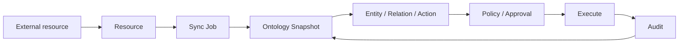

Data Xpert organizes metadata and capabilities from external systems into a governed object space. Users register a `Resource`; Agents consume `Entity`, `Relation`, and `Action` instances projected from a published `Ontology Snapshot`.

## Page actions and system objects

| User action | Main object | Observable result |
| --- | --- | --- |
| Register an external resource | `Resource` | resource ID, type, connection reference, and capabilities |
| Run a full or incremental sync | `Sync Job` | job status, stage, cursor, and failure reason |
| Open the ontology workspace | `Ontology Snapshot`, `Graph Version` | current version, health, entity, relationship, and triple counts |
| Search an entity or open its graph | `Entity`, `Relation` | type code, external key, attributes, and neighborhood |
| Discover an action | `Action`, affordance | allowed actions, denial reasons, and readiness |
| Simulate an action | policy decision, approval request | parameter validation, risk, and approval requirement |
| Execute an action | adapter execution, effect | result, artifact, and source-system response |
| Review execution audit | `Audit` | task, trace, snapshot, policy, and evidence references |

## Object boundaries

### Resource

`Resource` registers a connection and its capabilities in the control plane. It answers what the resource is, how it connects, and what it can sync or execute. Registration alone does not make a snapshot ready.

### Sync Job

A `Sync Job` is one synchronization request and its queue state. `full` rebuilds the resource projection; `incremental` updates it using a cursor supported by the adapter. A job must complete before a new snapshot can be published.

### Ontology Snapshot and Graph Version

An `Ontology Snapshot` is a published view of semantic facts, including sources, entities, relationships, actions, and statistics. A `Graph Version` identifies the runtime graph projection. Snapshots reproduce Agent context; graph versions locate graph-query results.

### Ontology Definition and Runtime Projection

An `Ontology Definition` is an editable definition and its immutable published versions in Ontology Studio. A `Runtime Projection` turns a published version and resource snapshot into searchable entities, relationships, and actions. Editing a draft does not change runtime data until validation and publication succeed.

### Entity, Relation, and Action

An `Entity` is an object instance with a stable type and external key. A `Relation` connects two entities with direction, endpoints, and properties. An `Action` is an executable semantic contract with a target entity, input schema, risk, and discovery mode. Defining an action does not grant permission or guarantee source-system execution.

### Policy, Approval, and Audit

`Policy` decides whether an action is allowed, denied, or sent for approval. An `Approval` applies to a specific target, parameter set, and expected effect. `Audit` records discovery, simulation, policy decisions, and execution evidence. Together they form the governed execution loop.

## `semantic_model` and `business_ontology`

`semantic_model` usually comes from an existing BI or OLAP semantic model and is suited to querying Cubes, dimensions, and metrics. `business_ontology` is a domain definition designed in Ontology Studio and is suited to stable business objects, relationships, owned instances, and domain actions.

They can be related at runtime but serve different purposes. Register and sync an existing semantic model first; create a `business_ontology` definition when you need cross-resource semantics, owned instances, or a domain governance contract.
