<Info>
**Applies to:** Current Data Xpert version.

**Prerequisites:** A published SQL semantic model, an available data source, a Secret, semantic-model permissions, and an Assistant.

**External dependency:** This tutorial requires a queryable SQL data source and a published semantic model. If no model is available, start with [Quick Start](../../getting-started/index).
</Info>

A SQL semantic model organizes relational fact tables, measures, and dimensions into a governed analysis contract. It enters the same ontology and Agent Tools flow as an SAP BW XMLA/MDX model, but uses SQL adapters and SQL actions. Agents provide published dimensions, measures, and time windows; they do not submit arbitrary raw SQL.

## Before you begin

Prepare a published SQL semantic model, an available data source, an Assistant, and a resource access policy. Replace the example model names, IDs, dimensions, and measures with values from your organization.

## SQL and XMLA models

| Item | SQL semantic model | SAP BW/XMLA semantic model |
| --- | --- | --- |
| Fact query actions | `sql.query_metric_snapshot`, `sql.query_cube_slice` | `mdx.query_metric_snapshot`, `mdx.query_cube_slice` |
| Runtime adapter | SQL/Doris adapter | XMLA/MDX adapter |
| Agent input | Governed semantic DSL | Governed MDX semantic DSL |
| Raw statement | Not allowed | Not allowed |

The action name contains `sql`, but the request parameters are still validated against the target `semantic_cube` analysis contract. If the model has no valid time dimension, use a Cube slice without a time window or publish a corrected model version first.

## Execution flow

```mermaid
flowchart LR
  A[SQL data source] --> B[Published SQL semantic model]
  B --> C[business_ontology resource]
  C --> D[Ontology Snapshot]
  D --> E[Assistant resourceIds]
  E --> F[queryEntities]
  F --> G[discoverActions]
  G --> H[simulateAction]
  H --> I[executeAction]
  I --> J[LiveArtifact validation]
  J --> K[Runtime query with viewer policy]
```



The creator must pass the resource allowlist, business-domain, action-registry, and policy checks when saving a binding. Viewers are checked again when they open or refresh the artifact; organization sharing does not bypass resource permissions.

## 1. Confirm the model is published

In **AI Workspace → Data Intelligence → Semantic Models**, search for the target SQL model and confirm that it is published. Record its model ID and version. Publication is required before the ontology snapshot can be generated or refreshed.

Verify the fact table, Cube, measures, dimensions, and time dimension in the modeling workspace. These names must exist in the published version, rather than only in a draft.

## 2. Inspect the ontology resource

Open **Data and Ontology → Ontology Workspace** and locate the semantic-model resource. A published SQL model is projected as a `business_ontology` containing `semantic_cube`, `semantic_measure`, and `semantic_dimension` instances.

Use `queryEntities` to locate a unique `semantic_cube`. Carry the returned `resourceId`, `snapshotId`, and `entityRef` into later calls; do not mix an entity reference from an older snapshot into a new binding.

## 3. Authorize the Assistant

In **AI Workspace → Assistants**, add the SQL resource to the Assistant's `resourceIds` while preserving existing authorized resources. Save the business-domain and resource binding as one configuration update. A resource allowlist defines what the Assistant may request; each action still requires a policy decision.

## 4. Discover, simulate, and execute the SQL action

Use the following governed flow:

```text
queryEntities → discoverActions → simulateAction → executeAction
```

Example target:

```json
{
  "resourceId": "<resourceId>",
  "target": {
    "entityTypeCode": "semantic_cube",
    "entityRef": "<modelId>::<cube>"
  }
}
```

The action parameters describe published dimensions, measures, granularity, and limits. They must not contain a raw SQL statement. Execute only after `simulateAction` returns `ALLOWED`, using the same target and parameters.

## 5. Build and review the LiveArtifact

LiveArtifact bindings should store the resource, action type, target, and normalized parameters. The service rechecks resource state, target entity, action policy, Assistant context, and viewer permissions when the artifact is saved and refreshed.

Use standard effect v2 fields such as `columns`, `rows`, `summary.returnedRowCount`, and `summary.truncated`. Charts only render the effect; they do not perform discovery, execution, or authorization. Truncated rows must not be presented as a complete KPI.

## Checklist

- [ ] The SQL semantic model is published and its resource has a current snapshot.
- [ ] The Assistant resource allowlist includes the target resource.
- [ ] `queryEntities` returns a unique `semantic_cube`.
- [ ] `discoverActions` returns the expected read-only SQL action.
- [ ] `simulateAction` succeeds before `executeAction` runs.
- [ ] The LiveArtifact shows source, update time, row count, and truncation state.
- [ ] Viewer permissions are checked again at runtime.
