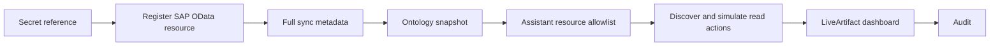

<Info>
**Applies to:** Current Data Xpert version.

**Prerequisites:** An accessible SAP OData service, a Secret, resource-sync permissions, and an Assistant with the required read actions.

**External dependency:** This scenario requires an SAP OData service and approved credentials. If no SAP resource is available, start with [Quick Start](../../getting-started/index) and use an existing semantic model.
</Info>

This scenario follows a procurement manager's request: “Show purchase-order, supplier, product, and sales-order indicators, then produce a refreshable dashboard.” The user describes the business outcome; Data Xpert locates authorized Entity Sets, discovers and simulates read-only actions, and renders the result as a LiveArtifact.

## What you will build

- an `sap-odata-resource` and its ontology snapshot;
- an Assistant authorized to use the resource;
- read-only bindings for purchase orders, suppliers, products, and sales orders;
- a dashboard with KPI cards, charts, and detail tables;
- an audit trail for each discovery, simulation, policy decision, and execution.



## 1. Register and sync the resource

Create the SAP connection in **Data and Ontology → Secrets**, then register an external resource in **Data and Ontology → Resource Access**. Store only the `connectionRef`; do not put credentials in resource capabilities or Assistant instructions.

Select the required service roots and run a **Full Sync**. In the ontology workspace, verify the Entity Sets, Entity Types, key schemas, query capabilities, and current snapshot.

Typical read-only Entity Sets include:

| Business purpose | Example Entity Set | Initial action |
| --- | --- | --- |
| Purchase orders | `zPurchaseorderSet` | `sap_odata.read_collection` |
| Suppliers | `BusinessPartnerSet` | `sap_odata.read_collection` |
| Products | `ProductSet` | `sap_odata.read_collection` |
| Sales orders | `SalesOrderSet` | `sap_odata.read_collection` |

Actual names and fields come from the service `$metadata` and the published snapshot.

## 2. Configure the Assistant

Create or open a procurement Assistant and add `sap-odata-resource` to its resource allowlist. Keep the system instructions focused on the business goal and boundaries: use only authorized Entity Sets, discover and simulate read actions, report source and update time, and never add values from different currencies without an explicit conversion rule.

The resource allowlist is one boundary. The current viewer must still have permission for the resource and `sap_odata.read_collection` action when the dashboard is opened or refreshed.

## 3. Ask for the dashboard in business language

Use a request such as:

```text
Create a “SAP Procurement Operations Command Center” from the authorized SAP OData resource. Show purchase-order, supplier, product, and sales-order counts; add a company-code purchase-amount chart and a sales-order status chart; include detail tables; use read-only Entity Sets; return at most 50 rows per binding; show update time and truncation; do not combine different currencies into one KPI.
```

The Assistant should select the authorized resource, discover the read actions, simulate each binding, and create the dashboard only after policy and parameter checks succeed.

## 4. Review the result

The dashboard should expose the source, snapshot, update time, returned row count, and truncation state. ECharts and tables render standard effect v2 data; they do not call SAP directly or bypass action policy.

Use **Governance → Execution Audit** to trace the dashboard's task ID through discovery, simulation, policy, and execution. If a binding fails, inspect its action denial reason and fix the resource, snapshot, Assistant allowlist, or policy before retrying.

## Checklist

- [ ] SAP Secret and connection reference are configured.
- [ ] The resource full sync completed and produced a `ready` snapshot.
- [ ] Each Entity Set is located in the current snapshot.
- [ ] The Assistant allowlist contains the resource.
- [ ] Each binding uses a read-only action and passes simulation.
- [ ] The dashboard shows source, update time, row count, and truncation state.
- [ ] Viewer access and execution audit remain valid after sharing.
