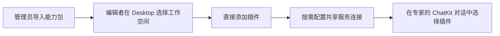

Desktop 侧栏的 **+** 打开“发现与添加”。这里有四类内容，它们分别解决不同的问题。

| 分类 | 适合什么需求 | 添加后发生什么 |
| --- | --- | --- |
| 数字专家 | 使用一个已经发布的专家 | 打开对话；需要授权时先申请访问 |
| 应用 | 启用一套包含专家、工作界面和业务资源的方案 | 完成应用初始化，再打开应用的入口专家 |
| 插件 | 查看和管理专家工作空间可用的能力包 | 有编辑权限的用户直接添加到工作空间；再到对话中选择使用 |
| 智能体模板 | 基于现成配置创建自己的专家 | 在有编辑权限的工作空间安装一个新专家 |

这四个入口不会互相替代：**应用**提供完整方案，**插件**扩展能力，**数字专家**是使用入口，**模板**用于创建自己的专家。

## 数字专家：找到可以直接协作的专家

1. 选择当前组织，打开“发现与添加 → 数字专家”。
2. 按名称、业务场景或能力搜索，也可以使用分类筛选。
3. 查看专家的描述、发布者和能力标签。描述会按当前界面语言显示。
4. 对于可访问的专家，点击 **立即使用**。需要授权的专家可以填写用途并申请访问；已提交的申请会显示等待状态。

获得使用权不等于获得专家的编辑权，也不会额外开放专家所连接的数据。

## 应用：启用完整业务方案

应用的产品介绍与通用使用流程见 [Plugin Apps](/zh-Hans/ai/applications/index)；模型、工具配置与初始化步骤见[发现与启用应用](/zh-Hans/ai/applications/app-guide/discovery-and-setup)。

应用可以包含多个协作专家、工作界面、知识资源及初始化流程。卡片使用应用截图作为淡化背景；详情页可以通过截图轮播了解界面。

1. 打开“应用”，搜索或按业务分类选择方案。
2. 进入详情，查看说明、截图、初始化步骤和当前状态。
3. 尚未初始化时，按照页面检查结果配置所需模型，再执行初始化。有些应用需要组织管理员权限。
4. 初始化完成后，点击使用，进入应用的入口专家及工作界面。

应用初始化中或失败时，先刷新检查状态，避免连续重复安装。已经就绪的应用会复用已有入口。

## 插件：直接添加到工作空间

“插件”是 **工作空间插件库**。选择框直接列出当前组织中你有编辑权限的工作空间，支持名称搜索。无需先选择数字专家，也无需跳转到平台管理页完成添加。

### 添加步骤

1. 打开“发现与添加 → 插件”，搜索并选择目标工作空间。
2. 查看组织内已导入的插件、真实头像、版本和所包含的能力。
3. 点击 **添加到工作空间**，核对工作空间、版本及能力列表。如果插件包含协作专家角色，为每个角色选择自己有权使用的已发布专家。
4. 点击 **添加插件**。系统直接准备此工作空间的技能、工具及必要依赖，完成后卡片显示 **已添加**。
5. 打开属于该工作空间的专家，在 ChatKit 的 **插件** 菜单中选择需要的插件。

| 状态 | 含义与下一步 |
| --- | --- |
| 已添加到此工作空间 | 插件已对该空间可用；在对话中选择使用 |
| 尚未添加到此工作空间 | 可以直接在 Desktop 添加 |
| 此工作空间已停用 | 管理员停用了现有发布；联系管理员恢复，重复添加不会绕过停用 |

重复添加会复用同一工作空间已有的有效配置，不生成重复插件，也不会修改其他工作空间或已有对话。没有可编辑工作空间时显示空状态。权限在服务端每次请求时重新检查，不能通过修改工作空间标识绕过。

### 权限与功能边界

- **工作空间编辑者**：浏览组织已导入包的展示信息，添加到自己能编辑的工作空间。不会收到包的本地路径、源地址、MCP 配置或凭据。
- **管理员**：仍负责 Git/ZIP 导入、组织级版本管理、停用及恢复。编辑者不能通过添加来升级或恢复已停用的发布。
- **服务连接管理员**：仍负责共享连接的创建与授权。如果所需连接尚未准备好，需先由相应管理员配置；添加插件不授予第三方数据访问权限。
- **ChatKit**：继续负责当前会话的插件选择和运行状态检查。插件添加到空间后不会自动选中，也不修改专家的发布图。

服务连接和标准 Agent Plugin 包并非同一对象。部分原生服务连接可以直接在 ChatKit 中选择，不必先导入一个 Agent Plugin 包。

### Desktop 中完成连接

需要授权或配置时，在对话的插件菜单中点击 **连接账号**：

1. ChatKit 发出连接命令后，Desktop 直接打开浏览器，不再弹出额外确认框。Xpert 自动进入目标服务的连接流程，无需再次点击“配置工作空间连接”。未登录或组织不一致时，先使用与 Desktop 相同的账号及组织登录。
2. 按服务要求完成授权、填写凭据或扫码。OAuth 在发起连接的浏览器标签中继续，以保留授权会话。
3. Desktop 自动检查服务端连接状态，确认就绪后回到前台、结束等待提示，并继续原来的插件选择流程。无需手动“检查连接”。

等待最多持续 10 分钟，超时后可以重试。点击取消或切换专家会停止 Desktop 等待；这不会撤销已经在服务端完成的授权。消息草稿保留在 Desktop 中。普通用户可以使用已经获准的共享连接；创建和修改共享连接仍要求相应管理权限。

插件选择只影响当前会话，不会修改专家的发布图。新增选择在下一次执行生效；正在执行的任务继续使用它启动时的配置。具体版本和权限规则见 [ChatKit 插件、中间件与数字专家](/zh-Hans/ai/chatkit/chatkit-agent-plugins)。

## 智能体模板：创建自己的专家

模板按智能体插件、Xpert 插件、系统内置和共享来源分组。详情预览、安装恢复、首次配置、例行任务、分享及升级见[智能体模板使用指南](/zh-Hans/ai/agent/conversation/assistant-templates)。

1. 打开“智能体模板”，查看模板说明并选择合适的配置。
2. 选择有编辑权限的工作空间，填写新专家的名称。
3. 安装完成后打开新专家，按需要继续配置和使用。

模板会创建新的专家实例；它与直接使用已有专家不同。属于应用整套方案的资源应从“应用”入口初始化，以便保留其资源依赖关系。

## 常见问题

**已经导入插件，为什么 ChatKit 找不到？**

检查是否发布到了当前专家所属工作空间，发布是否启用，以及当前用户是否有访问权限。组织可见、包已导入和会话可选是不同状态。

**添加到工作空间后会自动用于所有对话吗？**

不会。添加只让该空间的专家可以选到插件；具体对话仍通过 ChatKit 的统一菜单选择。

**连接成功后，为什么有些能力仍不可用？**

连接授权不等于插件发布或数据授权。还需要检查发布范围、组件配置及该用户可用的服务权限。
