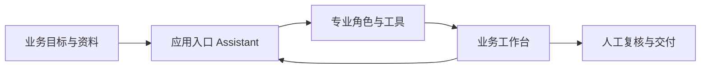

**Plugin Apps（插件应用）**是基于 Xpert 插件体系交付的业务应用，也称 Agentic Apps。应用围绕一项业务工作，组合入口 Assistant、专业工具、业务界面和所需资源，让用户在对话中安排工作，在工作台中处理业务并检查结果。

例如，一套文档编制应用可以提供材料上传、目录编排、章节写作与审阅流程；一套业务案例应用可以围绕同一案例组织资料、处理步骤与结果。具体流程和交付形式由各应用定义。

本栏目介绍应用的通用使用方式，并作为**官方经典应用产品文档**的统一入口。已收录 [Bid Studio 标书应用](./bid-studio/index)、[Code Review 代码审查](./code-review/index)、[Maps 地图](./maps/index)和 [Sites 站点](./sites/index)，更多产品将继续加入[官方应用目录](./catalog)。

## 应用带来什么

| 产品能力 | 使用体验 |
| --- | --- |
| 面向业务的入口 | 直接进入负责该项工作的 Assistant，了解可以处理的任务与所需资料 |
| 专业分工 | 应用可以组合入口助手、协作角色和独立专家，按声明的流程完成工作 |
| 业务工作台 | 在对话旁查看、编辑或复核业务对象，按应用规则推进状态 |
| 配套资源 | 初始化应用声明的工作空间、知识库及工具配置，集中维护所需能力 |
| 项目与任务集成 | 支持集成的应用复用项目成员、文件、任务视图和执行记录 |
| 可检查的结果 | 通过业务记录、文件或 Artifact 查看成果，再按应用流程确认和交付 |

这些是应用可以组合的能力。某款应用是否提供项目任务、知识库、协作角色或导出功能，应以其产品文档和实际界面为准。

## 从哪里开始

<CardGroup cols={2}>
  <Card title="完成第一个应用任务" icon="play" href="/zh-Hans/ai/applications/quickstart">
    从打开应用到提交资料、检查结果，走完一次小范围业务流程。
  </Card>
  <Card title="官方应用目录" icon="grip" href="/zh-Hans/ai/applications/catalog">
    查看本栏目的收录范围，以及各类产品文档的阅读入口。
  </Card>
  <Card title="发现与启用应用" icon="circle-plus" href="/zh-Hans/ai/applications/app-guide/discovery-and-setup">
    了解应用详情、启用条件、工具配置和初始化状态。
  </Card>
  <Card title="项目与任务协作" icon="list-check" href="/zh-Hans/ai/applications/app-guide/projects-and-tasks">
    在业务流程中选择正确项目，跟踪任务、执行与验收。
  </Card>
</CardGroup>

## 与 Bosi、插件和模板的关系

| 入口 | 主要用途 |
| --- | --- |
| [Bosi App](/zh-Hans/ai/bosi/index) | 桌面工作入口，可以发现、启用和使用业务应用 |
| Plugin App | 一套可初始化、授权和维护的业务方案，用户通过其已发布 Assistant 使用 |
| [插件开发](/zh-Hans/ai/plugin/overview) | 为平台实现工具、服务、视图等能力，并交付应用 |
| [智能体模板](/zh-Hans/ai/agent/conversation/assistant-templates) | 按可复用配置创建独立的 Assistant 实例 |
| [项目与任务](/zh-Hans/ai/projects/index) | 为长期工作提供协作空间、任务组织和执行记录 |

应用是否出现在当前目录，取决于服务已加载的插件及当前组织范围。应用就绪后还需要相应使用授权；业务数据、项目和外部服务继续执行各自的访问规则。详细操作见[权限与应用维护](./app-guide/access-and-updates)。
