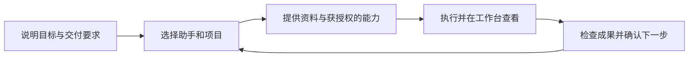

**Bosi（Xpert Bosi）是 Xpert 平台的桌面应用，也是你组织 AI 工作的入口。你定目标，Bosi 带队。**

你可以使用自己的 Bosi 助手处理日常工作，添加组织里的数字专家和业务应用，邀请同事与 Assistant 在群聊中协作。对话用于说明目标、补充信息和确认操作；工作台用于查看资料、业务界面、任务进展和交付成果。

<CardGroup cols={2}>
  <Card title="开始使用 Bosi" icon="rocket" href="/zh-Hans/ai/bosi/quickstart">
    安装并登录，创建个人 Bosi，完成第一个有明确交付要求的任务。
  </Card>
  <Card title="组织你的数字专家" icon="users" href="/zh-Hans/ai/bosi/daily-work/assistants-and-apps">
    发现专家、初始化应用、添加插件，把常用能力放到手边。
  </Card>
  <Card title="围绕项目协作" icon="list-check" href="/zh-Hans/ai/bosi/daily-work/projects-and-groups">
    用项目共享资料和任务，在群聊中安排多人、多 Assistant 分工。
  </Card>
  <Card title="使用电脑与编程工具" icon="desktop" href="/zh-Hans/ai/bosi/daily-work/computers-and-coding">
    按任务选择云电脑、服务端沙箱或经过授权的本机 Shell。
  </Card>
</CardGroup>

## 一个窗口中的工作方式

| 工作区域 | 你可以做什么 |
| --- | --- |
| 组织与侧栏 | 切换组织，查找助手和群组，置顶常用入口并按个人习惯分组 |
| 对话 | 描述目标、提供附件、选择插件和技能，查看工具结果并处理审批 |
| 助手形象与摘要 | 查看当前活动、成果和可用电脑入口，按权限定制助手名称与形象 |
| Workbench 工作台 | 在对话旁查看应用界面、项目任务、文件、图表或云电脑 |
| 设置 | 调整个人显示偏好、连接服务、查看用量和管理本机执行权限 |

例如，你可以让 Bosi 根据项目资料准备评估报告，再选择相关专家核对信息，在工作台查看报告与任务进展，最后检查并下载正式交付文件。具体可用的工具和应用来自所连接的 Xpert 服务。

## Bosi、个人助手与平台

| 名称 | 含义 |
| --- | --- |
| Bosi App | 安装在电脑上的客户端，提供侧栏、连接管理、对话和工作台入口 |
| 你的 Bosi | 当前账号在当前组织中使用的个人助手，可配置模型和可用能力 |
| 数字专家与 Agentic App | 组织发布的专业助手与业务应用，按各自权限使用 |
| Xpert 平台 | 提供模型接入、助手运行、业务资源、项目、发布和授权管理 |

Bosi 需要联网连接 Xpert 服务。安装桌面客户端不会在本机自动安装后端，也不会让助手获得整台电脑的访问权。模型、云电脑、插件、语音和外部服务是否可用，由当前部署、配置及授权共同决定。

## 从当前目标开始

- 处理专业业务：[数字专家、应用与插件](./daily-work/assistants-and-apps)。
- 推进长期交付：[项目与群聊协作](./daily-work/projects-and-groups)。
- 查看过程和成果：[对话、工作台与交付](./daily-work/conversations-and-workbench)。
- 执行代码或操作电脑：[电脑与开发任务](./daily-work/computers-and-coding)。
- 调整使用体验：[个性化、设置与更新](./desktop-guide/personalization-and-settings)。
- 解决连接、初始化或运行问题：[故障排查](./desktop-guide/troubleshooting)。

逐步安装操作保留在 [Bosi 桌面应用使用指南](/zh-Hans/ai/tutorial/bosi-desktop-user-guide)，开发实操见[使用 Bosi 进行开发](/zh-Hans/ai/tutorial/develop-with-bosi)。
