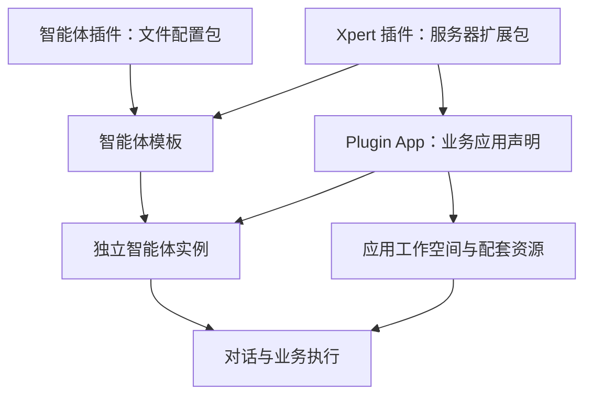

Xpert 用插件交付能力，用应用组织业务方案，用模板创建智能体。选择时先判断：你要增加服务器功能、分发一组配置、启用完整业务应用，还是创建自己的智能体？

## 四个概念的关系

| 概念 | 中文界面名称 | 交付内容 | 使用后的结果 |
| --- | --- | --- | --- |
| Agent Plugin | 智能体插件 | 技能、MCP 配置、智能体模板及素材等文件 | 包中的模板可被发现；其他资源按权限添加到工作空间或对话使用 |
| Xpert Plugin | Xpert 插件 | 原生服务器扩展，也可附带技能、模板与应用声明 | 平台增加实际服务能力或可安装资源 |
| Plugin App / Agentic App | 应用 | 插件通过 `appConfig` 组合的业务方案 | 初始化业务工作空间、入口智能体及声明的配套资源 |
| Assistant Template | 智能体模板 | 可复用的角色、执行配置、依赖与初始化要求 | 在目标空间创建独立智能体 |

这四者不是四种互斥文件格式。智能体模板可以放在 Agent Plugin 中，也可以由 Xpert Plugin 提供。Plugin App 可以引用模板来初始化入口和协作角色。用户实际对话的是已经创建并发布的智能体实例。

## 如何选择

| 需求 | 推荐方式 | 原因 |
| --- | --- | --- |
| 分发办公角色、技能、MCP 配置、初始台账 | Agent Plugin + Assistant Template | 配置文件即可交付，便于复制、版本管理和复用 |
| 增加平台尚未实现的工具、接口、数据实体或集成策略 | Xpert Plugin | 需要可执行的服务端实现 |
| 为一个组织部署包含多角色、业务工作台和知识资源的方案 | Plugin App，由 Xpert Plugin 贡献 | 需要组合资源、初始化状态及稳定的应用身份 |
| 基于现成角色创建个人或团队可编辑的助手 | 导入 Assistant Template | 创建自己的实例，可调整配置并显式升级 |
| 直接使用已有专家 | 数字专家目录 | 进入已有发布实例，无需再导入模板 |

文件配置包仍依赖目标系统已经支持的模型、工具、沙箱和连接器。一个 MCP 配置可以描述如何连接服务，但不会凭空实现该服务。需要新服务器能力时，可以先安装原生插件，再让多个文件模板复用它。

## 能力应该写在哪里

智能体做什么，由智能体定义决定：角色与指令、实际技能依赖、可用工具，以及首次使用和例行任务要求。插件是交付载体，不应再维护一套重复的“智能体能力清单”。

模板详情的“记忆、技能、例行任务、集成”来自这些声明。应用页面的业务亮点用于解释业务价值，“应用包含”则展示实际组合的角色与资源；两者不应重复同一份宣传文案。

依赖绑定的含义是把模板中的资源引用解析到目标环境的真实资源，例如某个技能、MCP 服务或工具集，并记录其版本。它不绑定宣传语，也不等于给智能体授予全部插件能力。

## 导入、添加、授权与使用

| 动作 | 作用 | 还需要什么 |
| --- | --- | --- |
| 管理员导入 Agent Plugin | 校验并保存组织可用的文件包与版本 | 根据用途安装模板或发布工作空间资源 |
| 安装 Xpert Plugin | 按插件要求加载服务器实现与资源 | 完成配置，必要时按平台提示重启服务 |
| 添加插件到工作空间 | 让获准用户能使用该空间的插件资源 | 配置所需连接，并在适用的对话入口选择 |
| 导入智能体模板 | 创建智能体、安装指定依赖并初始化内容 | 配置模型、账号、偏好及发布状态 |
| 初始化应用 | 创建或复用该组织应用的组合资源 | 分配维护和使用权限，完成业务配置 |
| 授权外部服务 | 建立目标账号的可用连接 | 仍需满足工作空间、智能体和第三方服务权限 |

复制包文件只是分发方式，正式使用仍需经过平台导入校验。安装成功不会自动登录第三方账号；组织应用就绪也不代表每个员工都获得使用权。工作空间编辑权限与已发布智能体的使用权限分开管理。

应用当前初始化为私有工作空间，初始化者负责维护；业务用户通过组织用户组获得已发布智能体使用权。详细步骤见[应用初始化配置](/zh-Hans/ai/plugin/application-config)与[智能体和应用授权](/zh-Hans/ai/system/permissions/assistant-application-authorization)。

## Office Ops 与模板系列

Office Ops 是文件配置型智能体插件：模板、七个办公技能、初始台账和默认暂停的例行任务组合在同一个包中，不需要为这个角色单独开发 NestJS 模块。模型、文件操作、审批和调度使用平台已有能力。

插件仓库 `agent-plugins/assistants/` 将 Office Ops 与其他角色统一管理，共 90 个模板包，覆盖销售与客户、市场营销、运营管理、个人事务、产品管理、设计创意、工程研发、招聘与人才。分类帮助用户发现角色，不改变权限和运行方式。

模板使用统一系列头像，中英文名称与介绍随界面语言显示；内部技能和执行指令不要求同步翻译。插件图标和智能体头像是不同配置入口，因此只换插件图标不会自动替换模板头像。

这些角色在 Xpert 的模板契约上实现，不承诺可以直接导入其他产品的私有模板文件。

## 版本与升级分别管理

包版本描述交付内容；模板来源版本用于判断实例能否升级；用户账号、偏好、对话、文件和任务状态属于实际实例。

安装新版包不会静默覆盖已有智能体。用户在升级预览中检查差异和本地冲突，保存草稿并发布后才使用新定义。应用初始化修复也不等于模板升级或数据库迁移。

跨来源迁移可以把原生插件中的模板转到 Agent Plugin，前提是明确选择新来源并通过兼容检查。相同显示名称不会被当作相同身份。

## 继续阅读

- [智能体模板使用指南](/zh-Hans/ai/agent/conversation/assistant-templates)：发现、导入、配置、任务、分享和升级。
- [发现与添加](/zh-Hans/ai/agent/conversation/discover-and-add)：四类入口的操作方式。
- [应用初始化配置](/zh-Hans/ai/plugin/application-config)：业务应用如何声明资源和初始化。
- [ChatKit 插件、中间件与数字专家](/zh-Hans/ai/chatkit/chatkit-agent-plugins)：对话中的选择及运行边界。
