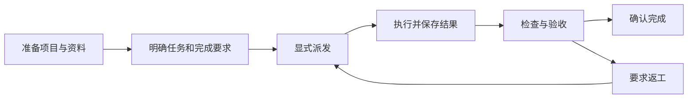

项目是围绕一个持续目标组织工作的协作空间。你可以把相关 Assistant、成员、文件、指令和会话放在一起，再将目标拆成可分工、可跟踪、可验收的任务。

例如，准备一份竞品评估报告：让分析员调研产品，数据员核对价格，写作员在前两项验收后编写报告。项目保存共同资料和规则；任务记录负责人、依赖、每次执行及最终验收结果。

<CardGroup cols={2}>
  <Card title="完成第一个项目任务" icon="list-check" href="/zh-Hans/ai/projects/quickstart">
    创建项目、准备资料，让 Assistant 制定任务并执行，最后检查交付结果。
  </Card>
  <Card title="在群聊中分工协作" icon="users" href="/zh-Hans/ai/projects/tasks/group-collaboration">
    关联群项目，选择参与的 Assistant，按依赖分批推进工作。
  </Card>
</CardGroup>

## 项目中有哪些内容

| 内容 | 用途 |
| --- | --- |
| Assistant 与会话 | 选择谁来完成工作，保留需求讨论和后续回复 |
| 项目指令与技能 | 统一术语、输出格式和可复用工作方法 |
| 成员与连接器 | 明确谁能使用、编辑和管理项目，以及可访问的业务系统 |
| 文件与产物 | 共享输入资料、保存工作文件、查看已交付的结果 |
| 计划与任务 | 组织里程碑、负责人、优先级、排期和前置依赖 |
| 执行与验收记录 | 区分每次尝试、独立审查、返工和最终完成决定 |
| 定时任务 | 在设定时间让指定 Assistant 以确认的用户身份运行 |

项目成员、参与项目的 Assistant 和群聊成员是三种关系。邀请同事进入群聊，或为 Assistant 开启项目管理，都不会自动赋予项目编辑权限。

## 从目标到交付

创建任务只保存计划。任务派发后才会执行，成功运行后通常进入**待验收**；负责的 Assistant 或有权限的用户依据结果确认完成。进度达到 100%、工具调用成功或群里出现“已完成”的回复，都不能替代验收决定。

## 选择合适的入口

| 入口 | 适合做什么 |
| --- | --- |
| Cloud 的项目列表 | 查找和创建项目，进入完整项目工作台 |
| 项目工作台的计划页 | 编排计划、里程碑、迭代和任务 |
| 项目工作台的项目任务页 | 查看任务树、甘特图、状态看板和执行详情 |
| Assistant 会话中的项目选择器 | 在发送需求前选择工作所属项目 |
| 会话 Workbench 的项目任务 | 一边对话，一边跟踪任务和验收结果 |
| 群聊输入框下方的项目菜单 | 由群主关联项目并确认参与的 Assistant |

Cloud 与 Desktop 的会话 Workbench 共用项目任务视图。完整项目工作台的页面操作以下文 Cloud 入口为例；可用 Assistant、应用类型、连接器和执行环境取决于当前部署与授权。

## 按当前需要继续

- 第一次使用：[快速开始](./quickstart)。
- 准备协作环境：[项目类型](./setup/project-types)、[Assistant、指令与技能](./setup/assistants-and-context)、[成员与权限](./setup/members-and-permissions)、[共享文件](./setup/files-and-deliverables)。
- 管理交付：[规划任务](./tasks/planning)、[查看任务与进度](./tasks/views)、[执行、验收与返工](./tasks/execution-and-review)。
- 持续运行：[群聊分工](./tasks/group-collaboration)、[项目定时任务](./automation/scheduled-tasks)。
- 遇到问题：[故障排查](./help/troubleshooting)。
