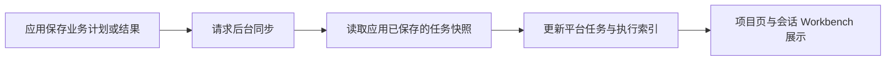

插件应用可以保留自己的任务模型，并通过 SDK 将已保存的业务事实映射到平台项目任务。这个映射称为**任务投影**：平台保存适合统一查看和排期的任务信息，业务操作仍由所属应用处理。

## 哪些信息可以一起呈现

| 应用中的信息 | 项目任务中的呈现 |
| --- | --- |
| 阶段、工作包或业务计划项 | 汇总节点、任务或里程碑 |
| 业务工作类别 | 应用注册的任务类型名称与图标，例如目录编制、正文编写或配图 |
| 任务拆分与执行前置条件 | 父子任务树和前置依赖 |
| 已分配的执行 Assistant | 任务负责人 |
| 业务状态和明确记录的完成比例 | 状态标记和进度百分比 |
| 每次领取、运行、失败或重新执行 | 对应任务下的独立执行尝试 |
| 执行关联的会话和运行记录 | 可授权访问的准确执行入口 |
| 失败原因与输出摘要 | 诊断信息与执行摘要 |

结构类型、业务类型、状态和进度分别表达不同含义。一个“正文编写”任务可以拥有子任务；它的图标不决定是否完成，100% 进度也不能替代应用验收。只提供摘要或文件路径，不会自动生成平台可下载的交付物。

## 从业务操作到统一视图

例如，应用保存“编写施工方案”这项工作后，该任务可以先以未开始状态出现。应用明确派发后，同一任务记录本次执行；结果提交并通过应用的业务检查后，再映射为相应业务状态。再次执行同一项工作时，应保留可追溯的尝试记录。

当前后台同步是异步的。请求已进入队列，只说明平台接收了同步请求；任务视图可能短暂显示上一次保存的状态。页面在可见时约每五秒重新读取数据，但这不是同步完成时间的保证。

<Note>
打开页面和手动刷新只读取平台已保存的任务及执行事实，不会重新运行 Agent，也不会替应用发起一次任务同步。持续不同步时，需要检查应用是否成功提交同步请求及后台诊断。
</Note>

## 同一项工作如何保持连续

应用为业务任务和每次尝试提供稳定的来源标识。平台据此关联相同任务及执行记录；重复同步不会因为标题变化而创建另一项工作。修改任务名称和更换显示语言也不应改变任务身份。

以标书应用为例，一个计划步骤可以先出现在任务树中，后续准备出实际业务任务时继续使用同一来源标识。应用再将执行尝试逐次关联到该任务，用户可以从统一入口回看每次过程。

真正新增的业务工作应使用新的业务标识；不能为了减少任务数量，把不相干的工作或多个执行尝试合并成一条记录。

## 在哪里修改

| 需要做的事 | 使用入口 |
| --- | --- |
| 改业务目标、拆分任务、调整业务依赖 | 所属应用的计划或业务工具 |
| 启动、重试、取消业务工作或确认结果 | 所属应用提供的操作，遵循其业务规则 |
| 调整计划日期和预计时长 | 有编辑权限时，在平台项目任务详情中修改 |
| 查看任务树、甘特图和执行状态 | 平台项目页或会话 Workbench 的项目任务 |
| 检查一次具体执行 | 对应任务的执行记录或执行圆点 |

平台排期不会改变应用的业务依赖，也不会到点自动派发。多人同时修改排期遇到冲突时，应重新读取并核对最新数据，避免覆盖其他人的安排。

## 运行结束与业务完成

一次 Agent 运行结束，只描述那次执行。应用可能还需要核对覆盖范围、内容质量、材料来源或提交结果，再决定业务任务是否完成。平台会保留应用给出的业务状态，避免以 Runtime 成功覆盖业务判断。

通用项目任务的“实施成功 → 待验收 → 接受或返工”流程见[执行与验收](../tasks/execution-and-review)。应用管理的任务使用该应用自己的验收入口；平台通用派发和验收工具不能接管这些任务。

点击某次执行时，平台根据保存的关联定位那次运行，而不是打开“最近一次对话”。应用没有提供可定位的 Agent 执行、历史记录缺失或权限变化时，可能只能查看摘要；不能以其他运行的内容补齐它。

## 同步异常时

| 现象 | 如何处理 |
| --- | --- |
| 应用已保存，平台暂时还是旧状态 | 等待后台同步后重新读取，先以应用保存结果确认业务是否成功 |
| 一直看不到新任务 | 检查业务对象是否关联到当前项目、应用是否支持任务接入，以及同步请求是否成功提交 |
| 出现同步诊断 | 由应用维护者检查 Provider、当前组织范围和项目访问权限，修复后重新请求同步 |
| 任务可见但不能改业务状态 | 回到所属应用操作，这是来源归属限制 |
| 有执行摘要但无法打开过程 | 检查该尝试是否提供了真实执行关联，以及当前用户是否仍可访问 |
| 应用不可用，列表仍保留旧任务 | 保留记录供查阅；先恢复应用和访问权限，再确认最新业务状态 |

后台同步失败会保留已有平台任务并记录诊断，已排队的同步可重试。若应用的业务提交成功但同步请求未入队，需要应用再次请求同步。不要通过重跑已完成的业务工作来修复显示问题。

接入实现与验证要点见 [SDK 接入指南](./sdk-integration)。
