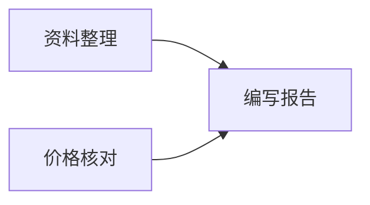

先明确要交付什么，再决定怎样拆分任务。一个任务应包含具体目标、完成要求和输出，使执行者知道如何做，也使验收者知道如何判断。

## 选择管理方式

创建项目时可以选择简洁模式或高级模式。这里的管理模式决定计划的组织方式，不是模型的推理模式，也不意味着任务会自动运行。

| 模式 | 适用场景 | 计划组织 |
| --- | --- | --- |
| 简洁模式 | 日常工作、小型交付 | 以未开始、进行中、已暂停和已完成四个基础泳道组织任务 |
| 高级模式 | 多阶段或多人分工的复杂交付 | 使用多个计划、里程碑和迭代组织任务 |

完整的任务状态还包括待验收、已阻塞和已取消。需要查看所有状态和执行事实时，使用[项目任务视图](./views)。

## 在计划页创建任务

1. 打开项目的**计划**页，选择当前计划。
2. 点击**添加任务**，在详情中填写名称、描述、优先级和截止日期。
3. 根据工作需要选择执行 Assistant；高级模式下还可选择计划和里程碑。
4. 保存后检查任务是否属于正确计划。在描述中写清预期交付，并让负责的 Assistant 在派发前确认可检查的完成要求。

计划页提供看板、表格、甘特图、日历和列表布局。它适合编排工作；项目任务页则集中展示依赖、执行尝试和验收证据。调整看板状态也不能绕过已有执行任务的验收要求。

也可以让具备项目管理能力的 Assistant 保存任务：

> 把竞品评估拆成资料整理、价格核对和报告编写。各任务写明完成要求、负责人和交付文件；报告必须等待前两项验收完成。

## 使用计划、里程碑与迭代

高级模式中，可以新增或编辑计划，新增和编辑里程碑，并创建迭代。

| 对象 | 建议填写的内容 | 示例 |
| --- | --- | --- |
| 计划 | 工作范围与计划状态 | 本季度竞品评估 |
| 里程碑 | 阶段目标、状态和截止日期 | 完成资料核验 |
| 迭代 | 本轮目标、策略、起止日期和状态 | 本周完成第一版报告 |
| 任务 | 可执行目标、负责人、优先级与完成要求 | 核实三款产品的价格 |

计划和迭代用于组织工作，执行记录仍保留在具体任务中。

## 父子任务与前置依赖

父子关系表示工作如何拆分；前置依赖表示一项工作在什么条件下可以派发。二者需要分别设置。

在这个例子中，“编写报告”的前置任务是“资料整理”和“价格核对”。它们可以同属一个父任务，但仅有父子关系并不能阻止报告提前执行。

有编辑权限时，可在项目任务详情的**概览**中调整层级、依赖、计划起止时间和预计时长。前置任务应来自同一项目，不能形成循环依赖；计划结束时间不能早于开始时间。保存冲突时，应刷新并重新核对其他协作者的修改。

由业务应用维护的任务，其层级和依赖应在对应应用中修改。通用项目任务视图会保留这些限制；任务如何从应用接入见[业务任务与执行同步](../plugin-apps/business-tasks)。

## 排期不会自动派发

计划日期表达预期安排，实际执行区间记录真正发生的运行。改日期、设置截止时间、增加前置依赖或创建任务，都不会自动开始执行。

后续任务需要在前置任务确认完成后，由协调 Assistant 明确派发。若希望每天或每周触发工作，应另外配置[定时任务](../automation/scheduled-tasks)。
