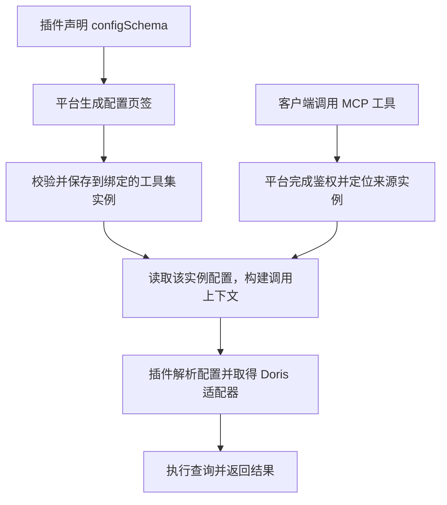

开发一个带 MCP 功能的业务插件，需要把业务查询、连接配置和对外发布衔接起来。以 Doris 订单查询为例，插件负责定义“能查询什么、接受什么参数、返回什么结果”；Xpert 平台负责把这些能力发布为 MCP 服务，并提供鉴权、配置界面和调用管理。

`xpert-skills` 中的 **`xpert-plugin-development`** 为开发过程提供工程规范和实现指引。本教程围绕一个虚构的业务查询插件，解释从业务能力到 MCP 调用的开发逻辑，以及平台如何支持插件自定义 `configSchema`。

## 先明确插件要提供的业务能力

假设 Doris 已有订单表 `biz_order`，包含订单号、站点、状态、金额、更新时间和启用标记。这个插件提供三种只读操作，以及一份表结构资源：

| 能力 | 作用 | 调用时提供的信息 |
| --- | --- | --- |
| `ping` | 检查连接，返回当前数据库与数据库用户 | 无 |
| `get_server_time` | 获取数据库服务器时间 | 无 |
| `get_orders` | 查询允许访问的订单数据 | 可选站点、返回条数、是否包含停用订单 |
| `schema://business/orders` | 说明订单表的可访问字段 | 资源地址 |

开发首先确定这些契约。例如，`get_orders` 的 `limit` 默认是 100，`include_inactive` 默认是 `false`；结果包含 `data`、本批返回行数 `rowCount` 和是否截断的 `truncated`。金额精度、空值和稳定排序也属于契约的一部分。

数据库主机、密码和查询上限属于连接配置，不需要调用方在每次查询时传入。插件在实现查询时限定允许访问的表，并对筛选值使用参数绑定。站点筛选只是查询条件，数据访问权限仍需单独校验。

## 技能、插件和平台各负责什么

开发过程使用[官方 xpert-skills](https://github.com/xpert-ai/xpert-skills) 中的 `xpert-plugin-development`，按需参考原生 MCP 和 MCP 服务配置指引。技能帮助开发智能体对照目标 SDK 组织工程、实现能力并验证结果；插件运行时由平台加载和执行。

| 部分 | 职责 |
| --- | --- |
| 开发技能 | 指导工程结构、SDK 使用、构建、测试与交付 |
| 业务查询插件 | 定义工具与资源、实现查询逻辑、声明配置字段并校验业务规则 |
| Doris 数据源插件 | 提供数据库连接、查询适配器和连接释放等通用能力 |
| Xpert 平台 | 加载插件、保存实例配置、生成配置表单、发布 MCP 服务，并处理鉴权、策略和审计 |

按这个分工，开发工作依次形成业务契约、共享查询服务、工具声明、配置定义和验证用例。技能中的接口用法需要与目标平台及 SDK 版本核对，尤其是 MCP 配置页签与保存校验能力；加载技能本身不会给旧版平台增加这些能力。

## 业务方法如何成为 MCP 工具

插件先将连接解析、查询和结果转换放进共享业务服务，再通过原生 Tool Provider 声明对外能力。`@XpertToolProvider()` 描述提供程序，`@XpertTool()` 描述可调用的方法、输入结构与读写属性；表结构则通过资源声明提供。

平台加载插件后，识别这些声明并注册工具和资源。开发者仍需补齐插件入口、依赖、清单和构建产物，使声明及其实现进入实际安装包。具体接口见[插件原生 MCP 工具](../plugin/host-native-mcp-tools)。

对外发布时，**MCP Publication** 将选定的能力及其来源实例组织成一个 MCP 服务。外部客户端连接这个服务地址，平台再将工具调用路由到插件方法。Streamable HTTP、身份验证、权限策略和审计由平台承载，业务插件可以集中实现查询逻辑。

因此，插件安装、能力注册和 MCP 发布是三个相连的环节：安装让代码进入平台，注册让平台识别能力，发布决定哪个服务对外开放哪些能力。

## 用 configSchema 描述插件需要的配置

本例在 Provider 上定义 `configSchema`，声明一个标题为“配置连接”的表单。Schema 描述字段及规则，实际填写的连接信息则由平台保存。

| 配置项 | 业务含义 | 表单行为 |
| --- | --- | --- |
| `mode` | 使用平台数据源或手填连接 | 明确选择 `platform` 或 `manual` |
| 平台数据源 | 当前用户可访问的 Doris 数据源 | 在平台模式显示数据源下拉框 |
| 主机、端口、账号、密码、数据库 | 手填 Doris 连接信息 | 在手填模式显示；SQL 端口默认 9030，密码使用秘密字段控件 |
| `maxRows` | 单次查询最多返回多少行 | 本例默认 500，允许 1 到 500 的整数 |
| `queryTimeoutMs` | 数据库查询超时 | 本例默认 30000 毫秒，允许 1000 到 120000 的整数 |

字段类型、标签、条件显示和控件信息来自插件的 Schema。平台复用通用表单来渲染它，因此这个业务插件不需要单独实现连接页面。平台数据源的候选项由插件通过已有数据源能力获取，按明确的 Doris 引擎类型筛选；真正打开数据源时仍会校验当前调用身份的权限。

两种模式在插件中有明确的执行分支：平台模式通过数据源运行能力打开适配器，凭据由平台管理；手填模式使用 Doris 插件公开的连接工厂。连接失败时应返回对应错误，避免自动切换到另一套配置。

Schema 之外，插件还需要实现配置解析和业务校验。例如，手填模式必须有主机和数据库，平台模式必须选定数据源。保存时的 `validateConfig` 检查配置是否合法；执行前的解析则处理默认值、已有配置和当前运行条件。

配置字段也必须接入业务行为。`get_orders` 的实际返回上限应取调用参数 `limit` 与实例配置 `maxRows` 中的较小值，`queryTimeoutMs` 则传给查询适配器。这样表单里的设置才会影响查询结果。

## 配置保存在哪里，多个页签如何区分

这里的“实例”指平台中的一个**工具集实例**，有自己的 `toolsetId`、名称和配置。同一个插件可以创建多个实例，它们复用同一份工具实现和 Schema，但分别保存连接值。

例如，订单查询插件创建“华东订单”和“华南订单”两个实例，各自连接不同数据库。MCP 服务绑定哪个实例的能力，调用时就使用哪个实例的配置。

| 情况 | 配置关系 |
| --- | --- |
| 同一实例提供多个工具 | 这些工具读取该实例的同一份连接配置 |
| 同一插件创建两个实例 | 两份配置相互独立 |
| 两个 MCP 服务绑定同一个实例 | 共享该实例的配置；修改会影响两边后续调用 |
| 一个 MCP 服务包含多个插件或多个实例 | 每个有配置字段的来源实例分别提供配置页签 |

平台依据绑定实例的 Provider `configSchema` 生成页签。标题可以由插件定义；存在多个配置页签时，平台在标题旁附加实例名称，例如“配置连接 · 华东订单”和“配置连接 · 华南订单”。表单区域还显示实例名与插件包名，实例命名清晰就更容易辨认。没有配置字段的来源不会自动产生配置表单页签。

打开页签时，平台读取已绑定实例的现有值。保存也更新该实例，不会创建新的连接，更不会把这份配置复制到服务中的其他工具集。

开发时还需要区分几种名称相近的配置：

| 定义 | 所属范围 |
| --- | --- |
| 插件安装配置 `config.schema` | 插件安装层面的配置 |
| Provider `configSchema` | 工具集实例的字段定义；填写的值保存在实例中 |
| 中间件配置 | 某个数字专家中的中间件选项 |
| 工具输入 `inputSchema` | 一次工具调用的参数 |

这些配置可以复用字段定义，但值的归属和读取路径各自独立。

## 从保存配置到执行查询

平台把配置管理和工具执行连接到同一个来源实例，流程如下：

保存时，平台检查管理权限，按 Schema 和 Provider 规则校验值，再更新实例配置。已保存的密码通过掩码回显，保持掩码不变会保留原值；配置版本用于检测并发修改，避免旧页面覆盖新设置。

调用时，平台根据已发布能力绑定的 `toolsetId` 取得配置，通过 `context.host.credentials` 提供给插件。插件只读取本次调用所属实例的值，再按连接模式获取适配器。凭据不需要进入 MCP 工具描述，也不需要由客户端作为工具参数传递。

例如，“华东订单”保存了 `maxRows=5`，客户端请求 `get_orders(limit=100)`，最多得到 5 行。服务中另一个实例若保存了 `maxRows=50`，仍按自己的上限执行。插件若缓存连接，也必须按实例与配置隔离，并处理配置更新后的失效，才能保持这种行为。

## 同一套能力也可以用于数字专家

需要平台数字专家查询订单时，可以增加中间件，复用前面的业务服务与工具方法。专家模板负责预装所需中间件和业务说明，连接信息在使用时配置。

复用代码不代表自动共享配置。MCP 调用读取绑定工具集实例的配置，中间件读取自身的选项；两者可使用同一套字段定义和连接解析逻辑。模板只装配本业务所需能力，不包含连接凭据。

## 开发完成时如何判断结果正确

验证需要覆盖声明、配置和实际执行三个部分：

| 验证对象 | 要证明的行为 |
| --- | --- |
| 插件包与生命周期 | 构建产物齐全，`plugin-dev-harness` 能加载插件并发现预期能力 |
| 工具与资源契约 | 输入默认值、空值、金额精度、返回结构和错误路径符合约定 |
| 配置保存 | 条件字段校验有效，密码得以保留，过期版本不能覆盖新配置 |
| 配置归属 | 多实例互不串用；共享同一实例的服务使用同一份配置 |
| 实际 MCP 调用 | 客户端完成初始化、工具发现、查询和资源读取；保存的行数上限与超时进入执行逻辑 |

这些检查有不同的证据：构建与生命周期测试证明插件能够加载，接口与集成测试证明配置和调用行为，页面验证证明编辑体验。技能指导开发过程，最终仍需用目标平台上的实际结果确认实现。

字段控件可进一步参考[插件配置表单](../plugin/schema-ui-extension)，客户端接入方式见[平台 MCP 服务](../middleware/mcp-server/index)。
