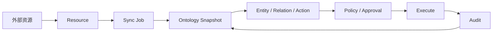

Data Xpert 把外部系统的元数据和能力整理为可治理的对象空间。用户在页面上注册的是 Resource，Agent 最终消费的是已发布 Snapshot 投影出的 Entity、Relation 和 Action。

## 页面动作对应系统对象

| 用户操作 | 主要对象 | 可观察结果 |
| --- | --- | --- |
| 新注册外部资源 | `Resource` | resource ID、类型、连接引用和 capabilities |
| 全量 / 增量同步 | `Sync Job` | job 状态、阶段、游标、失败原因 |
| 查看本体空间 | `Ontology Snapshot`、`Graph Version` | 当前版本、健康状态、实体/关系/三元组数量 |
| 搜索实体或打开图谱 | `Entity`、`Relation` | 类型编码、外部键、属性和邻域 |
| 发现动作 | `Action`、affordance | allowed actions、denied reason 和 readiness |
| 模拟动作 | policy decision、approval request | 参数校验、风险、审批要求 |
| 执行动作 | adapter execution、effect | 结果、artifact、源系统响应 |
| 查看执行审计 | `Audit` | task、trace、Snapshot、策略和证据引用 |

## 关键对象的边界

### Resource

Resource 是控制面中的连接与能力登记。它回答“是什么资源、如何连接、允许同步和执行什么”。注册 Resource 不会自动保证 Snapshot 就绪。

### Sync Job

Sync Job 是一次同步请求及其队列状态。`full` 首次重建资源投影，`incremental` 根据 adapter 支持的游标更新。Job 完成后才有机会发布新 Snapshot。

### Ontology Snapshot 与 Graph Version

Ontology Snapshot 是一次发布的语义事实视图，包含来源、实体、关系、动作和统计；Graph Version 是运行时图投影使用的版本标识。Snapshot 可用于复现 Agent 上下文，Graph Version 用于定位图查询结果。

### Ontology Definition 与 Runtime Projection

Ontology Definition 是本体工作室中的可编辑定义及其不可变发布版本；Runtime Projection 是把发布版本和资源快照投影成可搜索实体、关系和动作的运行时数据。本体工作室修改草稿不会直接改变运行时，必须校验并发布。

### Entity、Relation 与 Action

Entity 是有稳定类型和外部键的对象实例；Relation 连接两个实体并带有方向、端点和属性；Action 是描述可执行能力的语义契约，包含目标实体、输入 schema、风险和发现模式。Action 定义本身不授予权限，也不等于已经成功调用源系统。

### Policy、Approval 与 Audit

Policy 决定动作允许、拒绝或需要审批；Approval 针对具体 target、params 和 expected effect；Audit 记录实际发现、模拟、策略判定和执行证据。三者共同构成受控执行闭环。

## `semantic_model` 与 `business_ontology`

`semantic_model` 通常来自现有 BI / OLAP 语义模型，适合查询 Cube、维度和指标；同步 adapter 可以从源模型生成实体、关系和分析 Action。`business_ontology` 是在本体工作室中设计的业务领域定义，适合稳定实体、关系、手工实例和领域 Action。

两者可以在运行时关联，但用途不同：有现成语义模型时先注册并同步，不要为了“拥有本体”再手工复制一份相同资源；只有需要跨资源统一领域语义、手工实例或治理契约时，才创建 `business_ontology` 定义并绑定源资源。
